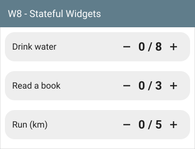
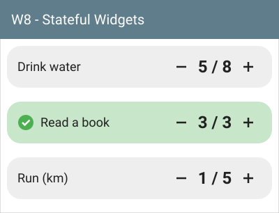

# W8 - Test (G2) – Stateful Widget `GoalCounter`

**Duration: 40 minutes**

## Your task

The starter code (`lib/main.dart`) contains a `GoalCounter` widget written as a **`StatelessWidget`**. It already displays the complete UI, but nothing happens when the buttons are pressed.

Convert `GoalCounter` into a **`StatefulWidget`** and implement the behaviour described below.

## Goal counter

A `GoalCounter` shows the goal's title, a **–** button, the text `count / target`, and a **+** button:

```
 _____________________________________________
|                                             |
|   Drink water          –     5 / 8     +    |
|_____________________________________________|
```

When the goal is reached, the card shows **done**: a green background and a check icon before the title:

```
 _____________________________________________
|                                             |
|  (✓) Read a book       –     3 / 3     +    |   <- green background
|_____________________________________________|
```

When the app starts, every counter shows `0 / target`:



Example after a few clicks (`Read a book` is done):



## Goals

A goal is defined by the `Goal` class (provided in the starter code):

```dart
class Goal {
  const Goal({required this.title, required this.target});

  final String title;
  final int target;
}
```

## Parameter

| Parameter | Type | Required |
|---|---|---|
| `goal` | `Goal` | Yes |

## State

| State | Type | Initial value |
|---|---|---|
| `count` | `int` | `0` |

## Behaviour

1. Pressing **+** increases the count by 1.
2. Pressing **–** decreases the count by 1.
3. The count can **never go above the goal's `target`** and can **never go below `0`**.
4. The text shows the current count and the target, e.g. `5 / 8`.
5. When `count == target`, the card shows **done**:
   - the background is green (`Colors.green[100]`) instead of grey,
   - a green check icon is shown before the title.

   When the count goes back below the target, the card is no longer done (grey background, no check icon).

## Main screen

The main screen is already provided: it shows three goals. Keep it. Each counter must keep **its own** count.

## Useful reminders

```dart
Colors.green[100]                              // light green background
Icon(Icons.check_circle, color: Colors.green)  // check icon
```
